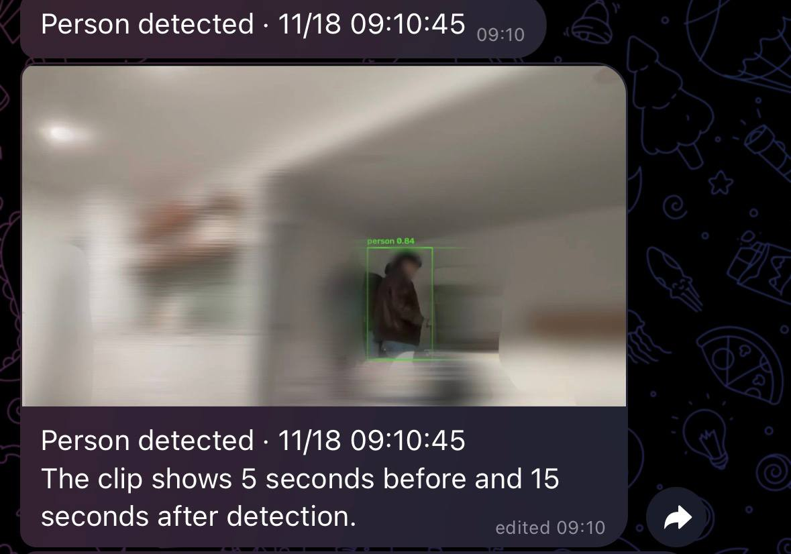

# Mac Sentry

[English](README.md) · [한국어 설치 가이드](INSTALL.ko.md)

**집을 나서면 맥이 자동으로 녹화하고 사람을 감지합니다. 돌아오면 멈춥니다.** 설정을 마치고 감시를 켜두면 아이폰의 외출·귀가 자동화에 맞춰 동작합니다. 내장 카메라를 쓰거나 맥 미니에 USB 웹캠을 연결해 사용할 수 있습니다.

- **맥에 녹화 저장.** 영상과 소리는 기본적으로 맥에 저장됩니다. 외장 드라이브로 바꿀 수도 있습니다. 촬영 시점부터 기본 24시간 보관하며, 기간은 설정에서 바꿀 수 있습니다.
- **텔레그램 알림.** BotFather에서 직접 만든 Sentry 전용 봇을 연결합니다. 외출·귀가 알림을 보내고, 사람이 감지되면 소리와 사람 표시가 포함된 영상 클립도 보냅니다. 원본 녹화는 그대로 남습니다.
- **비공개 라이브 시청.** 녹화 중 Tailscale에 연결하고 Safari에서 영상과 음성을 확인할 수 있습니다. 링크만 알아서는 볼 수 없습니다.
- **맥에서 직접 감지.** 클라우드 추론이나 백그라운드 AI 에이전트를 사용하지 않습니다.

### 텔레그램 알림 예시

## 준비물

macOS 14 이상이 설치된 Apple Silicon 맥, 지원되는 내장 또는 USB 카메라, 마이크가 필요합니다. 맥을 켜 두고 잠들지 않게 해주세요. 맥북 내장 카메라를 쓴다면 덮개를 열어두세요.

라이브 시청이나 외출·귀가 자동화를 쓰려면 [Tailscale](https://tailscale.com/download)을 설치하세요. 라이브를 보려면 시청 기기에 항상 Tailscale 연결이 필요합니다. 외출·귀가는 기본적으로 비공개 Tailscale을 사용하며, 아이폰에서 Tailscale을 끄고 쓰려면 인증된 HTTPS 신호 경로를 별도로 설정할 수 있습니다. 위치 좌표는 전송하지 않습니다. 맥에서 수동으로 녹화하고 조작할 때는 Tailscale이 필요 없습니다.

## 설치

저장소 링크와 아래 문장을 설치 에이전트에게 보내거나, [한국어 설치 가이드](INSTALL.ko.md)를 따라 직접 설치하세요.

> 이 저장소의 Mac Sentry를 제 맥에 설치해 주세요. INSTALL.ko.md를 따르고 감시는 켜지 마세요. 기기 권한 승인이나 텔레그램 봇 연결이 필요할 때 알려주세요.

아직 초기 버전입니다. 설치 가이드에 카메라를 켜지 않고 먼저 확인하는 방법과 실제 기기를 점검하는 방법을 따로 안내합니다. 자동 녹화를 사용하기 전에 아이폰 외출과 귀가 트리거를 각각 확인하세요.
