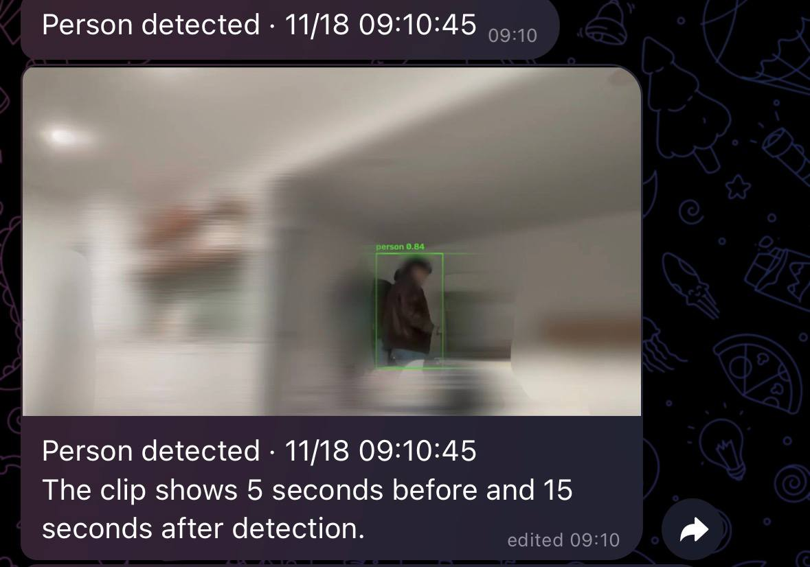

# Mac Sentry

[한국어](README.ko.md) · [한국어 설치 가이드](INSTALL.ko.md)

**Leave home and your Mac starts recording and detecting people. Come back and it stops.** Once set up and armed, Mac Sentry follows your iPhone's departure and arrival automations. Use a built-in camera or a webcam on a Mac mini.

- **Local recordings.** Video and sound are saved on the Mac by default. You can use an external drive instead. Recordings are kept for 24 hours from capture by default, and you can change the duration.
- **Telegram alerts.** Pair a dedicated bot that you create with BotFather. It sends start and stop notices, and when Sentry detects someone, a clip with sound and boxes around detected people. The original recording stays unchanged.
- **Private live view.** Watch and listen while recording in Safari over Tailscale. A copied link alone doesn't grant access.
- **On-device detection.** No cloud inference or background AI agent.

### Telegram alert example

## What you need

An Apple-silicon Mac running macOS 14 or newer, a compatible built-in or USB camera, and a microphone. Keep the Mac powered and awake. If you're using a MacBook's built-in camera, leave its lid open.

Install [Tailscale](https://tailscale.com/download) for live viewing or automatic Home/Away. Live viewing always requires a Tailscale connection on the viewing device. Home/Away uses private Tailscale by default, or a separately configured authenticated HTTPS signal if you want your iPhone to work with Tailscale disconnected. No coordinates are sent. Local recording and manual Mac controls don't require Tailscale.

## Install

Copy the repository link and this request to your setup agent, or follow [INSTALL.md](INSTALL.md) yourself:

> Install Mac Sentry from this repository on my Mac. Follow INSTALL.md, keep it unarmed, and ask me to handle any local permission or pairing prompts.

This is an early version. The runbook includes a camera-free test mode and separate device checks. Check both iPhone triggers before relying on automatic recording.
